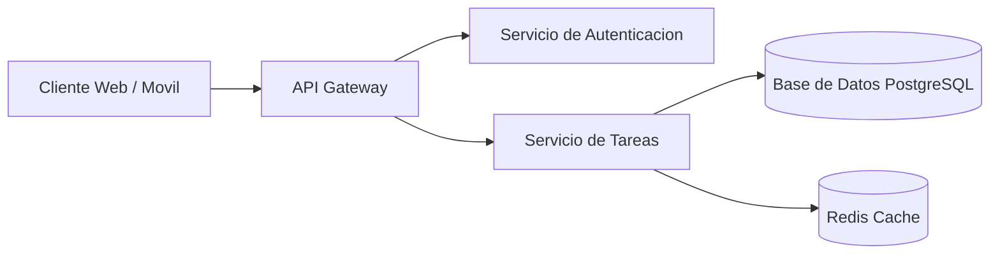
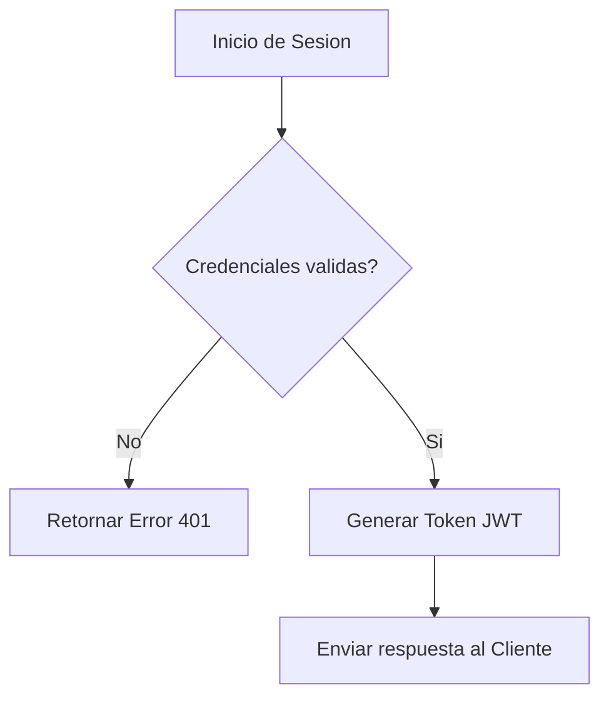

# TaskFlow API


API RESTful de alto rendimiento para la gestion integral de tareas, proyectos y flujos de trabajo colaborativos en tiempo real.

## Tabla de contenidos
- [Instalacion y Uso](#instalacion-y-uso)
- [Estado de las funciones](#estado-de-las-funciones)
- [Hoja de ruta](#hoja-de-ruta)
- [Ejemplos de codigo](#ejemplos-de-codigo)
- [Arquitectura](#arquitectura)
- [Contribucion](#contribucion)
- [Licencia](#licencia)

## Instalacion y Uso

### 1. Clonar el repositorio
```bash
git clone [https://github.com/favioet23-design/taskflow-api.git](https://github.com/favioet23-design/taskflow-api.git)
cd taskflow-api
npm install
```

### 2. Ejecutar la API en desarrollo
```typescript
import express from 'express';

const app = express();
const PORT = process.env.PORT || 3000;

app.get('/api/tasks', (req, res) => {
  res.json({ message: "Servidor TaskFlow activo" });
});

app.listen(PORT, () => {
  console.log(`Servidor ejecutandose en http://localhost:${PORT}`);
});
```

## Estado de las funciones

| Endpoint | Metodo | Estado | Prioridad |
|:---|:---:|:---:|---:|
| `/api/v1/auth/login` | POST | Listo | Alta |
| `/api/v1/tasks` | GET/POST | Listo | Alta |
| `/api/v1/tasks/:id` | PUT/DELETE | En curso | Media |
| `/api/v1/notifications` | WEBSOCKET | Pendiente | Baja |

## Hoja de ruta
- [x] Diseno de endpoints y esquemas de base de datos
- [x] Autenticacion JWT y gestion de usuarios
- [ ] CRUD completo de tareas y proyectos
- [ ] Notificaciones push en tiempo real

## Ejemplos de codigo

Peticion JSON para crear una nueva tarea:
```json
{
  "title": "Configurar pipeline CI/CD",
  "priority": "HIGH",
  "dueDate": "2026-12-01",
  "completed": false
}
```

## Arquitectura



### Flujo de autenticacion


## Contribucion
Aceptamos contribuciones de la comunidad. Por favor, lee la [Guia de Contribucion](CONTRIBUTING.md) antes de enviar un Pull Request.

## Licencia
Este proyecto esta licenciado bajo la Licencia MIT - consulta el archivo [LICENSE](LICENSE) para mas detalles.
